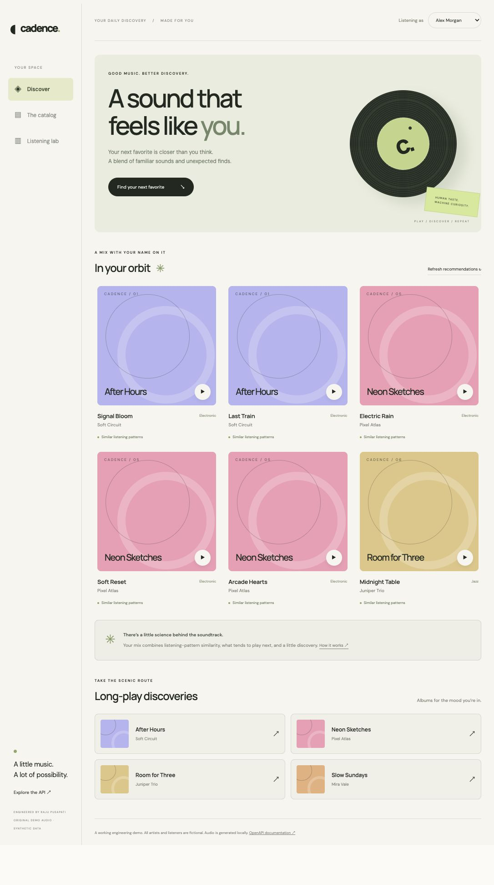
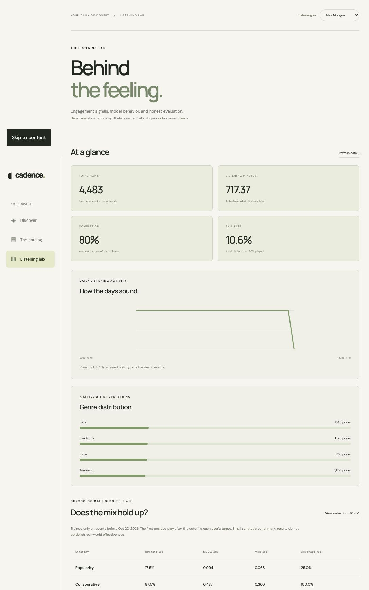

# Cadence · Music Streaming & Recommendation System

A working music-discovery application backed by a normalized SQL database, an explainable hybrid recommendation engine, FastAPI, and a source-controlled Power BI analytics project.

Built as an interview-ready engineering project: reproducible data, actual audio playback, explicit integrity rules, temporal evaluation, tests, and honest limitations.




## Showcase without real users

The no-account demo uses **40 synthetic listeners and 4,480 seeded plays**. Visitors can switch listeners, compare recommendations, play real demo audio, run read-only SQL reports, and inspect the evaluation table. Guest actions do not change real account histories or fabricate user traction.

Cloud mode also supports private Supabase accounts with email/password signup, signin, refresh, and signout. SQL data, migrations, and auth setup are documented in [Supabase setup](docs/supabase.md).

## What it does

- **Play and discover:** 24 original generated audio sketches, range-capable audio responses, searchable catalog, genre filters, album queues, and listener switching.
- **Personalize:** item-item collaborative filtering + first-order session transitions + popularity, with cold-start preferences, track-level explanations, and album ranking.
- **Record activity:** listening sessions, idempotent playback events, explicit likes, recommendation requests, and ranked track exposures.
- **Measure behavior:** an in-app listening lab, offline baseline comparisons, de-identified CSV exports, and a two-page Power BI report project with DAX measures.
- **Reproduce results:** 40 synthetic listeners and 4,480 deterministic seed plays, query-plan inspection, automated tests, and container/CI definitions.

All artist names, album names, listeners, and histories are fictional. The 12-second audio clips are locally synthesized examples, not licensed commercial recordings. Demo music differs by transposition/pattern; it is intended to exercise playback, not demonstrate a real music catalog.

## Run locally

Python **3.13+** recommended. The app was tested on Python 3.15 locally; CI also checks Python 3.13 and a container deployment. No API keys are required.

```bash
git clone https://github.com/PrkRaju2003/cadence-music-recommender.git
cd cadence-music-recommender
python3 -m venv .venv
source .venv/bin/activate
python -m pip install -r requirements-dev.txt
python -m cadence.seed
uvicorn cadence.api:app --host 127.0.0.1 --port 8000 --reload
```

Windows activation: `.venv\Scripts\Activate.ps1`.

Open [the app](http://127.0.0.1:8000) or [interactive API docs](http://127.0.0.1:8000/docs). The seed command is safe to rerun and does not delete listening activity. SQLite and generated WAV files live in `data/` and are ignored by Git. Set `CADENCE_DB` to select another database file.

## Container deployment

```bash
docker compose up --build
```

This binds the app to `127.0.0.1:8000` and persists SQLite/audio in a named volume. The Dockerfile initializes data, runs a health check, and serves FastAPI with a non-root user. It can be used on a container host with a persistent disk and `PORT` configured. See the current hosting instructions and deployment boundaries in [architecture](docs/architecture.md).

## Recommender design

```text
score = 0.50 × collaborative + 0.35 × next-track sequence + 0.15 × popularity
```

Collaborative scores use cosine similarity between log-weighted implicit item vectors. Sequence scores use adjacent positive plays inside a session. Components are max-normalized over candidates; scores are ranking signals, not probabilities. Cold-start listeners receive preferred-genre/popularity ranking. The currently playing/latest track is excluded; older favorites may return.



### Reproducible evaluation

```bash
python -m pytest -q
python -m cadence.evaluate
python -m cadence.export
python -m scripts.query_plans
python scripts/validate_powerbi.py
```

Training cutoff: **October 22, 2026 (UTC)**. Target: the first positive play after the cutoff per listener. The fixed seed benchmark contains 3,360 training events and 40 eligible users.

| Strategy | Hit Rate@5 | NDCG@5 | MRR@5 | Coverage@5 |
|---|---:|---:|---:|---:|
| Popularity | 0.1750 | 0.0941 | 0.0683 | 0.2500 |
| Collaborative | 0.8750 | 0.4872 | 0.3604 | 1.0000 |
| Sequence | 0.6750 | 0.4214 | 0.3387 | 1.0000 |
| Hybrid | 0.8750 | 0.5485 | 0.4433 | 1.0000 |

These are measured **synthetic-data results**, not real-user accuracy or production uplift. Hybrid ties collaborative filtering on hit rate while improving ranking position on this small benchmark. No held-out future interactions are used to train similarities or transitions. Full results: [evaluation.json](docs/evaluation.json).

The query-plan script compares indexed and unindexed reads on a disposable database copy. It records the actual SQLite planner output and local timings; see [query-plan.txt](docs/query-plan.txt). It does not claim production throughput.

## Supabase account mode

Copy `.env.example` to `.env` and configure the project URL and publishable key. No service-role key or database password belongs in the application. See [SQL, authentication, and hosting](docs/supabase.md).

## API examples

```bash
curl 'http://127.0.0.1:8000/api/recommendations/1?limit=5&context_track=1'
curl 'http://127.0.0.1:8000/api/recommendations/1?kind=album&limit=3'
curl 'http://127.0.0.1:8000/api/recommendations/1?strategy=sequence'
curl 'http://127.0.0.1:8000/api/catalog?genre=Jazz&search=light'
curl 'http://127.0.0.1:8000/api/analytics'
```

| Endpoint | Behavior |
|---|---|
| `GET /api/catalog`, `/api/genres` | Search/filter catalog and browse genres |
| `GET/POST /api/users` | Select or create demo listeners with genre preferences |
| `POST /api/sessions` | Start a listening session |
| `POST /api/playback` | Append bounded, idempotent playback events |
| `GET /api/users/{id}/history` | Read recent playback history |
| `POST /api/users/{id}/likes/{track_id}` | Store an explicit like; current ranking uses implicit playback signals |
| `GET /api/recommendations/{id}` | Rank tracks/albums and record request/exposure telemetry |
| `GET /api/analytics`, `/api/evaluation` | Engagement aggregates and fixed offline evaluation |
| `GET /media/{track_id}` | WAV streaming with HTTP byte-range support |

## Power BI

`powerbi/Cadence.pbip` contains an engagement report and a model-behavior report, an import semantic model (`model.bim`), relationships, and DAX measures. Run exports, configure the CSV path, open the project in Power BI Desktop on Windows, then refresh:

```powershell
python -m cadence.export
python scripts/configure_powerbi.py --data-dir .\exports
```

The report JSON is checked against official Microsoft schemas; tests verify visual field references and CSV column contracts. **Power BI Desktop rendering and refresh have not been verified on the macOS authoring machine.** See [Power BI setup](powerbi/README.md) before claiming a completed or published dashboard.

## Project map

```text
cadence/              FastAPI, database access, seed/audio generation, ranking, evaluation, exports
cadence/static/       Responsive player, catalog, and listening lab
sql/schema.sql        Normalized tables, constraints, triggers, views, and indexes
tests/                API, concurrency, ranking, database, export, and report-contract tests
powerbi/              PBIP report pages and semantic model
exports/              Sample de-identified analytics CSVs
scripts/              Query plans, HTTP smoke checks, Power BI generation/configuration/validation
docs/                 Architecture, measured evaluation, query plans, screenshots, and resume wording
.github/workflows/    Python tests, report validation, and container smoke test
```

## Design decisions and limits

This is a single-node portfolio demo. In offline SQLite mode, selectable listener IDs are not authentication. Supabase mode has authenticated, owner-scoped histories and a separate synthetic public showcase. Host the configured Supabase mode for account access; the unauthenticated SQLite sandbox is intended for local use. The in-memory similarity model is refit per request; production-scale serving would require offline sparse training, candidate retrieval, caching, artifact versioning, and a persistent service database. There is no billing, DRM, commercial catalog ingestion, or distributed training.

See [architecture and ER diagram](docs/architecture.md), [resume-ready wording](docs/resume.md), and [Power BI instructions](powerbi/README.md). The code and original demo audio generator are MIT licensed. Google Fonts are loaded as optional presentation assets; system fonts are used when offline.
