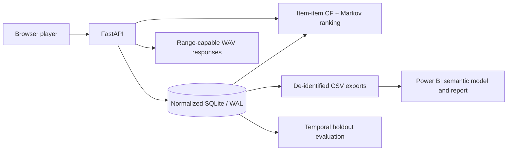
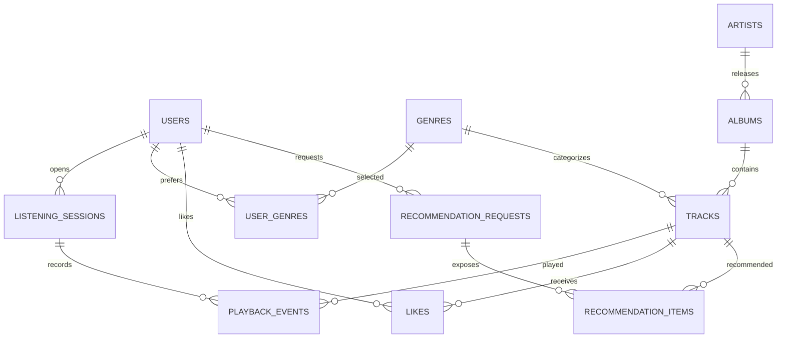

# Architecture and engineering decisions

## Relational model

Artist names are stored once; albums reference artists; tracks reference albums and genres. Playback references a session, and the session identifies the listener. User IDs are not redundantly stored in playback events. Composite primary keys model preferences and likes. Catalog and analytics views flatten these relations for reads without duplicating base data.

### Integrity and query behavior

Foreign keys are enabled on every connection. Unique constraints prevent duplicate album positions, duplicate likes/preferences, and duplicate event keys. Checks bound duration, track numbering, playback time, score, and rank. Insert triggers reject plays after a session closes, plays before a session starts, and playback longer than the track. The API only appends playback; it exposes no update/delete endpoint for events.

Queries use bound parameters. An idempotency key makes duplicate playback submissions return the original event; reusing the key for different content returns HTTP 409. Reads use indexes on user/session/time and track/time. `docs/query-plan.txt` records actual EXPLAIN output and a small local benchmark on a disposable database copy. The recent-history query still sorts a bounded listener history because time ordering spans multiple sessions; an index does not magically eliminate every sort.

### Why SQLite

SQLite makes the project reproducible with one command and no external credentials. WAL supports concurrent readers; each request owns a separate connection, with a 10-second lock timeout. FastAPI sync dependencies may cross worker threads, so connections allow this while remaining request-scoped. This design targets a single-node demo, not high-volume multi-region streaming. PostgreSQL migration, pooled connections, identity enforcement, and durable object storage are the next steps for a production system.

## Recommendation model

1. A completed fraction of at least 0.5 contributes an implicit preference. Per-user track counts are log-weighted with `log(1 + weighted_plays)`.
2. Tracks are represented by user vectors. Item-item cosine similarity transfers each listener's history into candidate scores.
3. A first-order Markov model counts adjacent positive plays inside the same session. It never bridges session boundaries or skips over a negative interaction to invent adjacency.
4. Each component is max-normalized across the current candidate set. Hybrid score = `0.50 * CF + 0.35 * sequence + 0.15 * popularity`.
5. Cold listeners use 75% preferred-genre match plus 25% popularity. Without chosen genres this becomes popularity ranking.
6. The currently playing/latest track is excluded; earlier repeats remain valid for a next-song task. Album recommendations use the mean of candidate-track scores in each album.

The sequence model is deliberately interpretable, not an RNN/Transformer. Scores are relative ranking signals, not calibrated probabilities. Weights are fixed for demonstration; tuning on the test set is avoided. The baseline table makes clear where hybrid helps and where it ties another strategy.

The model is refit per request to keep feedback immediate and implementation transparent. That is acceptable for 40 listeners/24 tracks, but item-pair similarity is quadratic in the catalog size. A production design would train sparse similarities offline, cache top neighbors and transitions, version artifacts, and rank candidates online. The latency metric includes the local fitting and ranking work, not network transfer.

## Evaluation

Training uses events before `2026-10-22T00:00:00+00:00`. The test target is each eligible user's first positive play after that cutoff. Evaluation ignores later browser activity by capping the benchmark at the seed period. All strategies see the same training data, candidate catalog, and immediate-repeat exclusion. Metrics: hit rate@5, NDCG@5, truncated reciprocal rank@5, and catalog coverage@5.

This is a deliberately small synthetic experiment with genre clusters and album-sequence patterns. Its results validate the pipeline; they do not establish product-market fit, production personalization quality, a fair comparison with larger learned models, or causal engagement uplift. See `docs/evaluation.json` for measured results.

## Playback, attribution, and deployment boundaries

The browser accumulates actual playback progress, ignoring large seek jumps. It writes an event when the track changes/ends and uses a best-effort beacon on page exit. Abrupt browser/process loss can still lose partial events. Completion is therefore an observed client signal, not fraud-proof listening telemetry.

Recommendation request and track exposure records support monitoring; a `recommendation` playback source is not causal attribution or click-through rate. Do not infer conversions from it without explicit request-item correlation and an experiment design.

The API is a local engineering demo with selectable synthetic identities, **not authentication**. Do not expose it to untrusted traffic unchanged. Public hosting requires authentication/authorization, CORS/origin review, rate limiting, request size limits, secure transport, operational backups, and a persistence strategy. Container deployment instructions are provided without claiming a live hosted backend.

## Supabase and public showcase update

The original SQLite sandbox is retained for offline development. The hosted app now uses Supabase Auth, PostgreSQL RPCs, private owner-scoped data, and a separate anonymous synthetic showcase. See [Supabase architecture and setup](supabase.md) for the current cloud path. The app runs on Vercel at https://cadence-prk.vercel.app/. Public HTTP verification is recorded in `hosted-check.json`.
